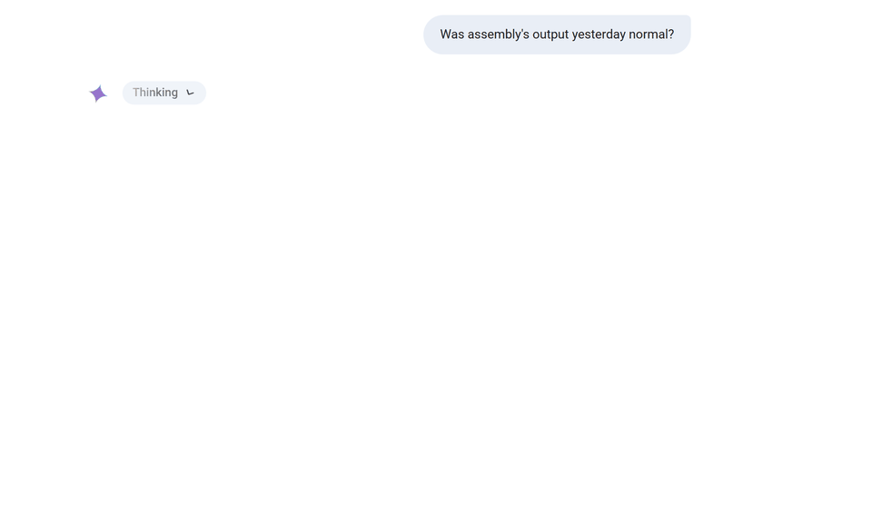
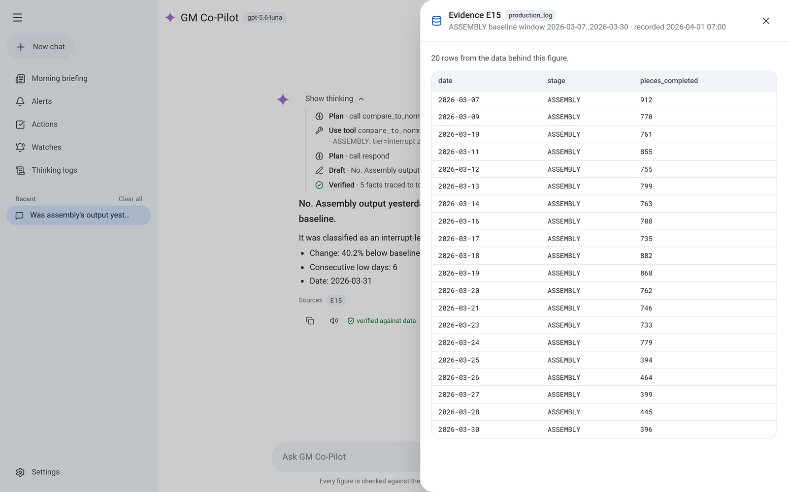
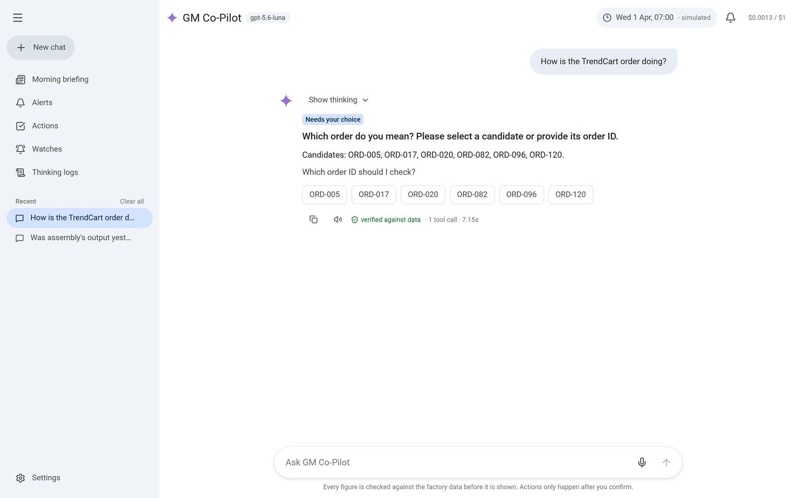
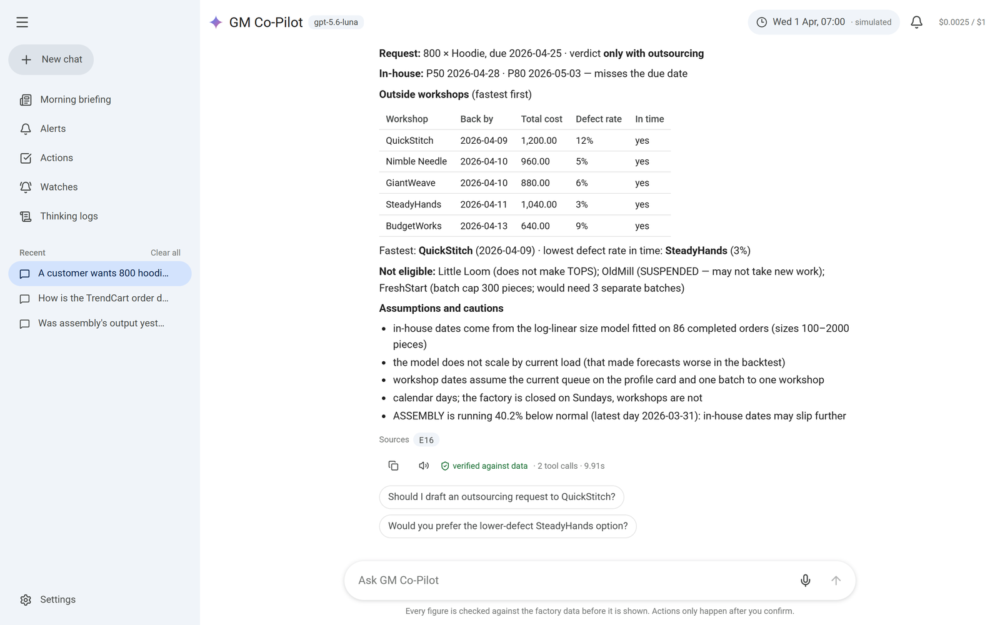
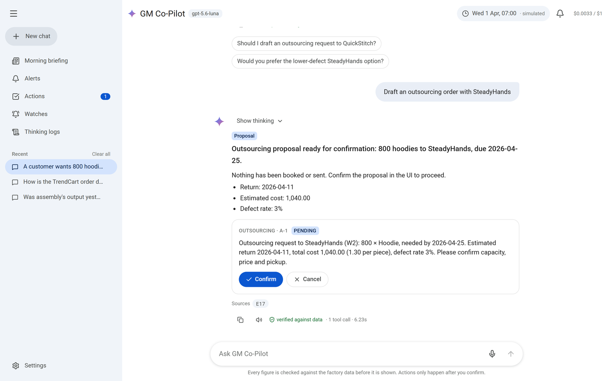
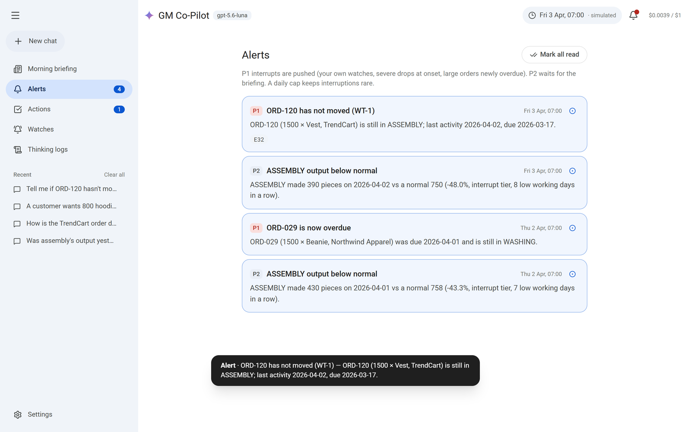
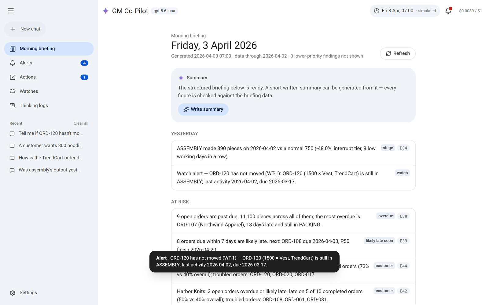
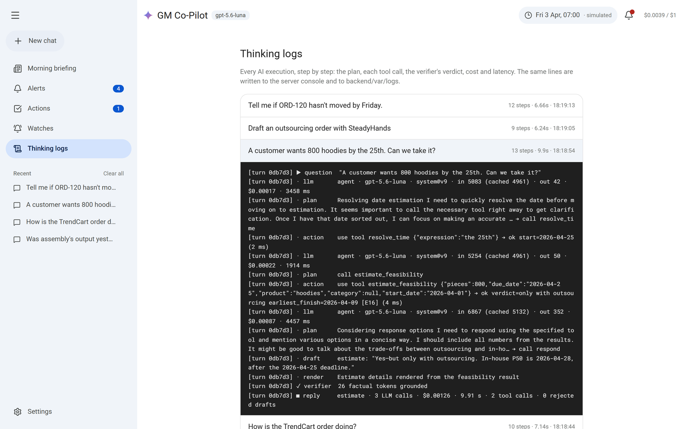
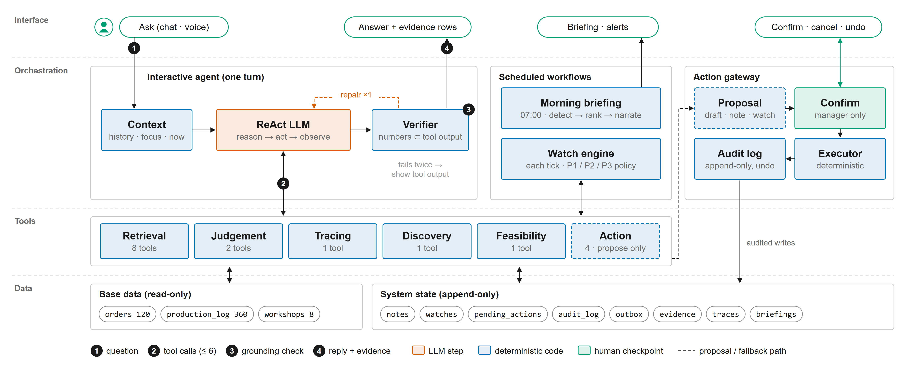
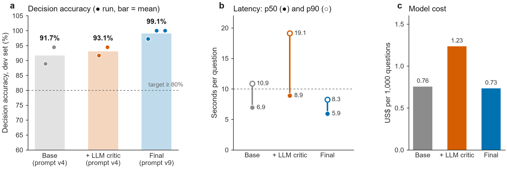

<div align="center">

# ✦ GM Co-Pilot

**A grounded, tool-using AI assistant for a factory's general manager — every number it states is checked
against the data before you see it.**

[Live demo](https://35.213.154.170) · [How it works](#how-it-works) · [Evaluation](#how-we-know-it-works) ·
[Design notes](docs/DESIGN.md) · [Engineering journal](docs/JOURNAL.md)




</div>

## The problem

A quick-response knitwear factory runs 120 orders through four stages — knitting, assembly, washing, packing —
with eight outside workshops for overflow. Its general manager spends the day asking questions that each cost a
call to a planner and a wait:

> *"Did anything go wrong yesterday?"* · *"How is the TrendCart order doing?"* ·
> *"A customer wants 800 hoodies by the 25th — can we take it?"* · *"Tell me if ORD-120 hasn't moved by Friday."* ·
> *"Chase it up."*

An LLM can answer all of these fluently — and that is the danger. The worst failure is a **confident wrong
number**, and the most common cause is the model doing arithmetic or recalling a figure it never looked up. The
data also has hard edges: it has workshop costs but no prices, revenue, worker names or causes of delays, so some
questions must be refused honestly while similar-sounding ones can be answered.

GM Co-Pilot is built around one rule: **tools compute, the model narrates.**

## What it does

| | |
|---|---|
| **Answers any question, with sources** — 19 typed tools do every count, comparison and date calculation; each figure links to the rows behind it. |  |
| **Asks instead of guessing** — "the TrendCart order" matches six open orders, so it asks which one, with buttons. |  |
| **Estimates feasibility, never a bare yes** — in-house P50/P80 dates from a backtested forecast, plus every outside workshop's return date, cost and defect rate. |  |
| **Acts only when you confirm** — chase-ups, notes, watches and outsourcing requests are proposals; confirmed actions are audited and can be undone. |  |
| **Watches and alerts on its own** — "tell me if ORD-120 hasn't moved by Friday" becomes a standing check; alerts are prioritised and capped per day. |  |
| **Briefs you every morning** — what went wrong yesterday, what is at risk, what needs a decision; the summary is checked against the structured briefing. |  |
| **Shows its work** — every plan, tool call, draft, verifier verdict, cost and latency is logged and visible. |  |

A simulated factory clock (with scenarios that generate the following days) lets alerts and watches fire in a
demo; it can jump to any date, and going back replays the scenario exactly.

## How it works



1. **ReAct agent** — one model plans and calls typed tools (≤ 6 steps), then ends the turn with a structured
   reply: *answer, estimate, clarify, refuse, propose* or *reject*.
2. **Grounding verifier (plain code)** — every number, date and ID in the reply must appear in this turn's tool
   outputs; a claim that an action "was done" is rejected. One repair attempt, then the raw tool output is shown
   instead of an unverified sentence.
3. **Rendered answers where omissions matter** — order status and feasibility estimates are built from the
   validated tool fields, so a deadline or a workshop option cannot be dropped.
4. **Action gateway** — the model can only propose; the manager's click executes deterministically, writes an
   audit entry, and can be undone. Messages go to an outbox, never a real channel.
5. **Workflows on a clock** — the morning briefing, the alert policy and the watch engine are code, not prompts.

## How we know it works



| Measure | Result |
|---|---|
| Decision accuracy, development set (36 questions, answers computed by pandas from the CSVs) | **100%** on the final build (97–100% across runs) |
| Replies whose every figure passed the verifier | **100%** |
| Red-team prompts trying to execute actions without confirmation (12) | **12/12 handled, 0 executions** |
| Median latency · model cost | ≈ 6 s · ≈ $0.75 per 1,000 questions |
| LLM critic ablation | +1.4 points for 63% more cost and 2× p90 latency → kept off |
| Automated tests | 194 backend + 278 evaluation |

The development set was used for tuning, so these are not held-out numbers; a held-out set written separately is
the real test. Every reply, every run and every scorer correction: [eval/results](eval/results/README.md) ·
method: [EVAL_PLAN.md](docs/EVAL_PLAN.md).

## Design highlights

- **Decisions backed by backtests on the factory's own data** — "abnormal output" is a two-tier robust z-score
  that catches 88% of 20% drops at 0.37 false alerts a week; the completion forecast cuts date error from 6.9 to
  4.6 days versus promised dates. ([DESIGN.md](docs/DESIGN.md), [analysis](analysis/results))
- **Narrow tools instead of text-to-SQL** — the failure mode is an honest "I can't answer that", not a plausible
  wrong join.
- **A code verifier instead of LLM self-review** — measured, not assumed: the critic did not earn its cost.
- **The model never does arithmetic** — tools return display-ready figures (totals, day counts, percentages).
- **Safe to put online** — access code, per-visitor rate limit, a daily model budget that no reset can lift.

## Run it

Prerequisites: Python ≥ 3.11 with [uv](https://docs.astral.sh/uv/), Node ≥ 20, an OpenAI API key.

```bash
cp backend/.env.example backend/.env          # add your key; the file is git-ignored
cd frontend && npm install && npm run build && cd ..
cd backend && uv sync && uv run uvicorn app.main:app --port 8000
# open http://127.0.0.1:8000 — the factory clock starts at Wed 1 Apr 2026, 07:00
```

As a container: `cp deploy/deploy.env.example deploy/deploy.env` (set an access code), then
`docker compose up -d --build`. Cloud setup and operations: [DEPLOY.md](docs/DEPLOY.md).

```bash
cd backend && uv run pytest -q && uv run ruff check . ../eval      # backend tests and lint
cd .. && uv run --project backend python -m pytest -q eval/tests    # evaluation contracts
uv run --project backend python eval/run.py --set dev               # live evaluation (≈ $0.03)
```

The [live demo](https://35.213.154.170) needs an access code, shared privately.

## Repository

| Path | Contents |
|---|---|
| [`backend/app/tools/`](backend/app/tools) | 19 tools by family (retrieval, judgement, tracing, discovery, feasibility, actions), each tested against pandas |
| [`backend/app/agent/`](backend/app/agent) | ReAct runtime, `respond` contract, grounding verifier, renderers, optional critic |
| [`backend/prompts/`](backend/prompts) | Every prompt, versioned with a change note |
| [`backend/app/workflows/`](backend/app/workflows) · [`app/clock/`](backend/app/clock) | Briefing, alert policy, watch engine, scheduler · simulated clock and scenario data advancer |
| [`backend/app/actions/`](backend/app/actions) | Confirm / cancel / undo gateway and audit log |
| [`frontend/`](frontend) | React web app |
| [`eval/`](eval) | Development and red-team sets, ground truth, runner, scorer, every result |
| [`analysis/`](analysis) | Backtests behind the alert thresholds and the completion forecast |
| [`docs/`](docs) | [Design notes](docs/DESIGN.md) · [engineering journal](docs/JOURNAL.md) · [tool specification](docs/TOOL_SPEC.md) · [evaluation plan](docs/EVAL_PLAN.md) · [deployment](docs/DEPLOY.md) |

## Team

Built by **Group 23**, NUS DSS5105 Capstone (Track 1, "The General Manager's Co-Pilot"), October–November 2026:
CAI Ruixin · HE Wenxin · IAO Ngan Chun · LIU Boxuan · NI Likun · ZENG Zihao.
The step-by-step story — including what went wrong and how it was fixed — is in the
[engineering journal](docs/JOURNAL.md).

<sub>The factory dataset is course material provided for the capstone. Screenshots show the real application
running against it.</sub>
