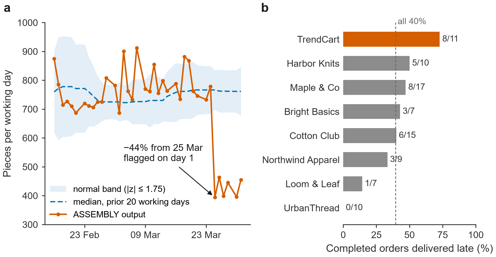
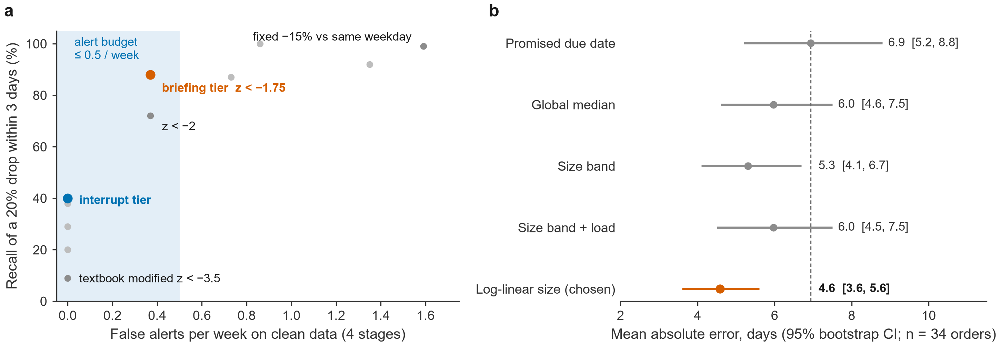
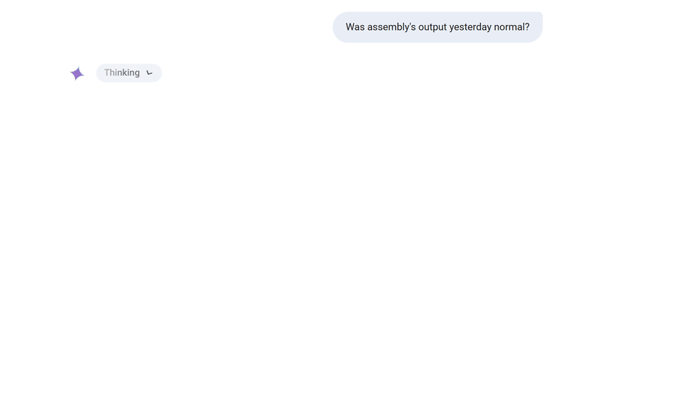
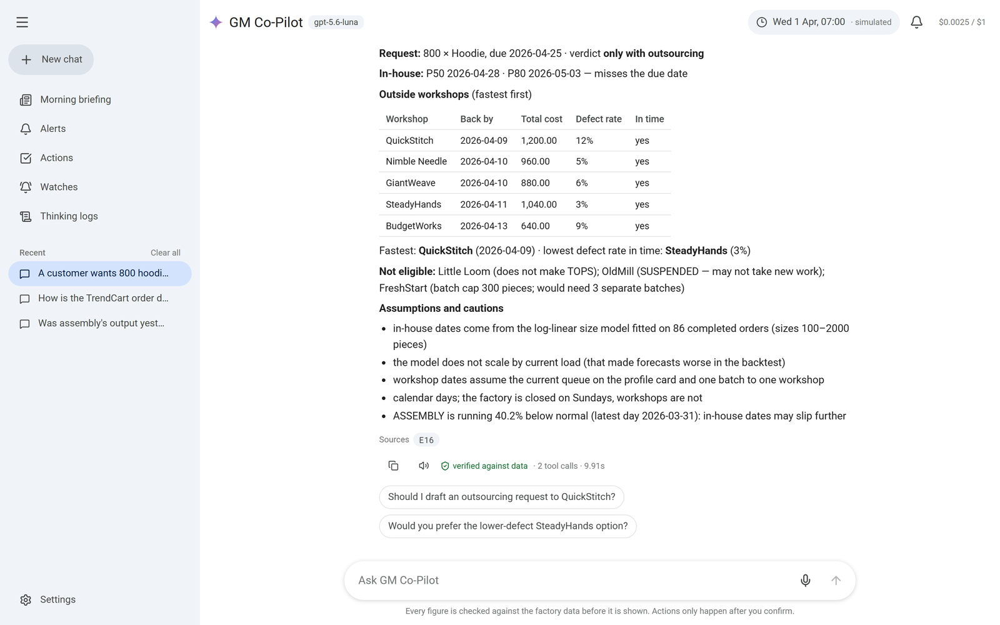
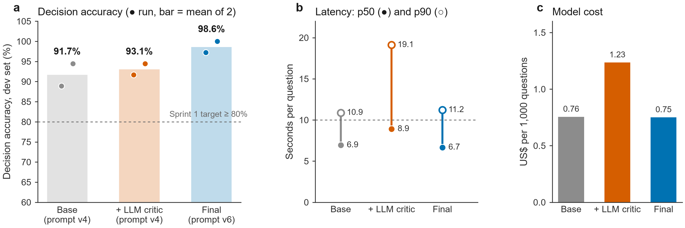
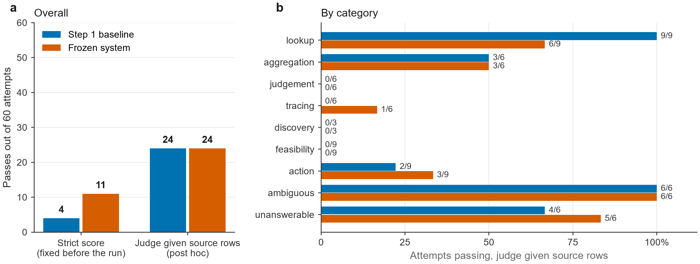

# Engineering journal

How GM Co-Pilot was built, step by step — what we did, why, the evidence, and what we learned, including the
mistakes. Design rationale is summarised in [DESIGN.md](DESIGN.md); every evaluation run is in
[eval/results](../eval/results/README.md).

| # | Step | Date (2026) |
|---|---|---|
| 1 | [Read the data before designing anything](#1-read-the-data-before-designing-anything) | 8 Oct |
| 2 | [Choose "abnormal" by backtest](#2-choose-abnormal-by-backtest) | 8 Oct |
| 3 | [Choose the completion forecast by backtest](#3-choose-the-completion-forecast-by-backtest) | 8 Oct |
| 4 | [Specify the tools before building them](#4-specify-the-tools-before-building-them) | 8 Oct |
| 5 | [Write the evaluation before the system](#5-write-the-evaluation-before-the-system) | 8 Oct |
| 6 | [Build the tools, each against an independent computation](#6-build-the-tools-each-against-an-independent-computation) | 8–14 Oct |
| 7 | [The agent: ReAct, a code verifier, and a trace of every step](#7-the-agent-react-a-code-verifier-and-a-trace-of-every-step) | 14 Oct |
| 8 | [Make time pass: clock, scenarios, watches, briefing](#8-make-time-pass-clock-scenarios-watches-briefing) | 14 Oct |
| 9 | [The web app](#9-the-web-app) | 15 Oct |
| 10 | [First evaluation: fix what it finds, test the critic, attack the actions](#10-first-evaluation-fix-what-it-finds-test-the-critic-attack-the-actions) | 15 Oct |
| 11 | [Answer contracts and deterministic order status](#11-answer-contracts-and-deterministic-order-status) | 20 Oct |
| 12 | [Deploy](#12-deploy) | 27 Oct |
| 13 | [Usability review: seven issues from a demo session](#13-usability-review-seven-issues-from-a-demo-session) | 29 Oct |
| 14 | [Live regression: three regressions found and fixed](#14-live-regression-three-regressions-found-and-fixed) | 29 Oct |
| 15 | [Comparison answers: complete, traceable, and honest about the cause](#15-comparison-answers-complete-traceable-and-honest-about-the-cause) | 1 Nov |
| 16 | [Two implementations, and what the other one's tests found](#16-two-implementations-and-what-the-other-ones-tests-found) | 1 Nov |
| 17 | [The held-out run: 36/36 becomes 11/60](#17-the-held-out-run-3636-becomes-1160) | 4 Nov |

---

## 1. Read the data before designing anything

**What.** Profiled the three CSVs (120 orders, 360 production rows over 90 days, 8 workshops) and listed the
signals a useful co-pilot must notice, and the traps it must not fall into.

**Found.** ASSEMBLY output fell from ~775 to ~422 pieces a day from 25 March (−44%) while the other stages stayed
normal; 8 open orders are past due (the worst 16 days); two orders have gone quiet; one customer was late on 8 of
11 completed orders; "the TrendCart order" matches six open orders; the example order ORD-058 is already
complete. The production log and the order book differ about 2× in scale, so the log is only usable for relative
signals. A naive mean that includes Sundays understates assembly output by 17%.

**Lesson.** These findings became test cases and evaluation items before any code existed.

## 2. Choose "abnormal" by backtest

**What.** Compared eleven rules for "is today's output abnormal?" on the clean period: false alerts per week, and
recall on 400 injected 3-day drops per size. ([analysis/threshold_backtest.py](../analysis/threshold_backtest.py))

**Result.** Robust z against the trailing 20 working days, in two tiers. The **briefing tier** (`z < −1.75`)
catches 88% of 20% drops at 0.37 false alerts a week; the **interrupt tier** (`z < −3` or 2-of-3 days `z < −2`)
raised none in 80 clean days. Fixed-percentage rules were noisier; textbook 3σ rules missed most drops. There is
no weekday effect, so same-weekday baselines add noise without benefit.

## 3. Choose the completion forecast by backtest

**What.** Walk-forward over 34 completed orders, each predicted only from orders finished before it was placed.

**Result.** A log-linear size model has the lowest error (4.6 days vs 6.9 for the promised dates), almost no bias,
and P80 coverage of 76%. Scaling by the current load made every model worse, so load is reported as a risk
factor, not multiplied in. ([analysis/projection_backtest.py](../analysis/projection_backtest.py))

## 4. Specify the tools before building them

**What.** Wrote [TOOL_SPEC.md](TOOL_SPEC.md): every tool's input, output, purpose, non-goals and failure modes —
retrieval, judgement, tracing, discovery, feasibility and actions (17 tools at first, 19 now).

**Why.** Text-to-SQL would answer more unanticipated questions, but its failure is a plausible wrong join. We
preferred tools whose failure is an honest "I can't answer that", with evidence rows behind every result.

## 5. Write the evaluation before the system

**What.** A 36-item development set across nine categories (lookup, aggregation, judgement, tracing, discovery,
feasibility, action, ambiguous, unanswerable/bait). Every expected answer is computed by a separate pandas script
from the CSVs ([eval/ground_truth/dev_truth.py](../eval/ground_truth/dev_truth.py)), not by the system's code.
Scoring separates **decision** (right behaviour and facts) from **faithfulness** (every figure verified).

**Why.** Writing the test after the system invites tests that the system happens to pass.

## 6. Build the tools, each against an independent computation

**What.** SQLite data layer and the tools in families under `backend/app/tools/`, each with Pydantic models and a
unit test that compares it with the pandas ground truth.

**Lesson.** Returning *display-ready* fields matters: when a tool returned a defect rate of `0.12`, the model had to
convert it to "12%" — which is arithmetic. Tools now return `defect_rate_pct`, total costs, day counts and the
total number of open orders, so the model never computes them.

## 7. The agent: ReAct, a code verifier, and a trace of every step

**What.** A ReAct loop over native function calling (≤ 6 tool steps), a structured `respond` contract, a
deterministic grounding verifier, one repair, and a raw-data fallback. Every step — plan, tool and arguments,
draft, verifier verdict, cost, latency — is traced to the database, a JSONL file and the console. Prompts are
versioned files.

**Lessons.**
- Strict function schemas made the model fill every optional field (`value: 0`, `product: ""`), which silently
  changed tool behaviour. Optional fields are now nullable and empty values are dropped before the call; median
  latency fell from 12–38 s to 5–8 s.
- A verifier that is too eager is a bug too: "nothing has been sent yet" was first read as a claim that a message
  had been sent. Negation handling is now unit-tested.

## 8. Make time pass: clock, scenarios, watches, briefing

**What.** A simulated clock (and a real-time mode), a data advancer that generates the following days from
scenario files, an alert policy with a daily interrupt cap, a watch engine for standing checks, and a morning
briefing assembled by code at 07:00 (an optional written summary is checked against it).

**Why.** With static data, an alert can never fire in a demo. Each simulated day is seeded by (scenario, date),
so runs are reproducible.

## 9. The web app

**What.** React + TypeScript + Tailwind, modelled on a familiar assistant UI: live "Show thinking" over
Server-Sent Events, an evidence drawer behind every source chip, clarification buttons, proposal cards with
confirm / cancel / undo, briefing, alerts, actions and audit log, watches, thinking logs, settings, voice input and
read-aloud, and a mobile layout.

## 10. First evaluation: fix what it finds, test the critic, attack the actions

**What.** An evaluation runner (fresh database per item, cost cap, every reply stored) and a unit-tested scorer.

**Found and fixed.**
- "Which workshop gets 1,500 crewnecks back first?" had no tool path, because feasibility required a deadline →
  the deadline became optional.
- Partial refusals ("the cost is X, but margin isn't in the data") were labelled inconsistently → the `respond`
  contract now says when to refuse.
- A red-team prompt got the agent to draft a message promising "ships tomorrow" for an order still in assembly →
  a rule against unsupported promises.
- A false verifier rejection ("none has been sent") forced a raw-data fallback → the negation list was widened.

**Critic ablation.** An LLM reviewer after the verifier added +1.4 points (inside run-to-run noise) for 63% more
cost and doubled p90 latency. The promotion rule (+5 points) was fixed before the runs, so the critic stays off.

**Honesty rule.** Some failures were the scorer's, not the system's ("unsent" matched "sent"). Every scorer or
label correction is unit-tested, re-applied to every run, and listed in the results README.

## 11. Answer contracts and deterministic order status

**What** (Zihao Zeng). Answer contracts for each dev item, a reproducibility baseline (hashes of the source and
data), and a purpose-built `get_order_status` tool whose validated fields drive a deterministic status reply —
so a status answer can no longer omit the due date. Notes: [STEP1_REPRODUCIBILITY.md](STEP1_REPRODUCIBILITY.md),
[STEP2_ORDER_STATUS.md](STEP2_ORDER_STATUS.md).

## 12. Deploy

**What** (Boxuan Liu). One container (FastAPI serving the built React app, SQLite on a volume) on a Google Cloud
VM behind Nginx with a Let's Encrypt certificate; access code, per-visitor rate limit and a daily model budget.
Reproducible setup and operations: [DEPLOY.md](DEPLOY.md).

## 13. Usability review: seven issues from a demo session

**What.** A teammate walked through the deployed demo and wrote down seven problems. Each was traced to a root
cause before fixing:

| Issue | Root cause | Fix |
|---|---|---|
| Briefing "Refresh" did nothing | It re-fetched instead of rebuilding | Refresh rebuilds from current data; "Rewrite summary" |
| Chats could not be deleted | No endpoint | Delete one or all (the AI execution log is kept) |
| Alerts could not be marked unread | One-way endpoint | Toggle read / unread |
| Time could not go back | Clock only moved forward | Jump to any time; going back replays the seeded scenario identically, keeping chats and evidence |
| Watches only via the chat; no cancel | Proposals are confirm-only by design; the UI lacked controls | Confirm / dismiss watch proposals and cancel watches on the Watches page — audited and undoable |
| "Draft an outsourcing order" did nothing | There was no such action | `propose_outsourcing`: checks the workshop can take the batch, states return date, cost and defect rate |
| Answer layout varied | The model wrote the details freely | Estimate details are rendered from the tool result (one table); a layout rule for the rest |

The review also surfaced a cost hole: starting a scenario reset the spend record, which would lift the daily
budget cap. Resets now keep it.

## 14. Live regression: three regressions found and fixed

**What.** Re-ran the full development and red-team sets against the live model after the changes above.

**Found.** Red team fell to 9/12 and one dev item failed twice. None was caused by a figure — faithfulness stayed
100% — but by behaviour:
- When asked to email a customer or change a due date, the agent correctly refused, but the deterministic
  order-status renderer (step 11) replaced the refusal with a status report → the renderer no longer overrides
  replies about a requested action.
- Asked to "set a watch on ORD-058", the agent asked which condition instead of proposing and letting the tool
  reject the completed order → a default watch condition.
- "So the watch is set now?" was answered "no pending watch", because `get_activity(kind="watch")` omitted pending
  watch proposals → pending proposals now follow the kind filter.

**Result.** Development set 36/36, red team 12/12 twice, every reply verified, no action executed without
confirmation.

**Lesson.** Deterministic renderers make answers reliable, but they need to know *which* question they own; and
unit tests with a scripted model cannot replace a live regression run.

## 15. Comparison answers: complete, traceable, and honest about the cause

**What.** "Why did assembly drop on 25 March?" is the question the data cannot fully answer, so the reply must say
what happened, against what baseline, and that the cause is unknown. One earlier reply gave 394 and the median of
766.5 but not the size of the drop.

**Found.** Working on it exposed two gaps beyond wording. The tool's evidence held the baseline window but not the
observed row, so 455 pieces on 31 March could not be traced from its source chip. And a question about a period had
no tool support, which left the model to average daily figures itself, against the rule that the LLM never does
arithmetic.

**Changed.** `compare_to_normal` now compares periods, reports missing data as unavailable, and puts the observed row
in the evidence. Single-stage comparison replies are rendered from its fields, like order status and estimates. A
period with a missing working day gets no mean, because a missing day is not a zero. The briefing summary is now
written on schedule too, and a failed one is not retried, so it cannot keep spending.

**Result.** D35 and twelve variations, three runs each on the live model: 39/39, including zero and missing baselines.
Full regression: development set 36/36 twice, red team 12/12 twice, every reply verified, no action executed without
confirmation. These are development numbers. The gate's limits are listed in
[STEP3_COMPARISONS.md](STEP3_COMPARISONS.md).

**Lesson.** A missing fact in an answer can point to a gap in the tool rather than in the prompt. Checking whether
each figure could be traced back found the evidence gap that a better prompt would have hidden.

## 16. Two implementations, and what the other one's tests found

**What.** While merging step 15 we found a remote branch with the same work already done. Zihao Zeng's pull request
showed as merged, but its base was a branch that had reached `main` 39 seconds earlier, so the code never arrived. It
held a second answer to step 15, and the independent scorer, judge, calibration and frozen runner we were about to
write. We kept one comparison route and took his evaluation tools with his authorship. Then we ran his cases, his
references and his judge against the route he had not written.

**Found.** Our own gate said 39/39. His said 29/33, and the judge rejected 6 of 13 real replies:
- With one day missing from the baseline window, the window silently moved back and still produced a percentage and
  a verdict. That is a defect in the tool.
- Once in three runs, the model refused a period with a missing day, which left the baseline out of the reply.
- The judge rejected correct z-scores its reference package did not contain, and called them unclear. It was partly
  right: a manager asking for a comparison had not asked for a z-score.

We fixed the first two and showed the verdict only when the question asks about normality. One finding went the other
way: the scorer rejected a correct reply, so we changed that rule. Another check shows the limit of all this: the
patterns came from the same contract as our renderer, and they fail a correct sentence from the older build. So the
rubric now requires a person to review such failures, and reports strict and reviewed scores side by side. We set this
before any hidden answer exists.

**Mistake.** Before re-running, we deleted the first failing run (30/33), which breaks our rule of keeping every
result. We re-ran from the same commit to restore the record. That run scored 29/33, so the two differed by one
attempt, and the results README says so.

**Result.** Independent cases 33/33, judge 13/13 on real replies, development set 36/36 twice, red team 12/12 twice.
These are still development numbers, and no person has calibrated the judge yet.

**Lesson.** A test written by someone else finds what your own cannot, because you share your code's assumptions with
your own tests. And a green "merged" badge says where a pull request went, not that it reached `main`.

## 17. The held-out run: 36/36 becomes 11/60

**What.** The planned held-out set arrived, and it could not be used. None of its 13 order references exist in the data, no question names a real customer, product or workshop, and it asks about scrap, headcount and machines that the files do not hold. It still passed every structural check, because its answers agreed with each other. We kept the file and its hash. We tagged the system first, so nothing could be tuned to the questions, and only then did the development assistant read the draft and move it onto real data: same categories and intent, entities drawn by a fixed seed, references computed from the CSVs by a script. So the set cannot have been tuned to, but it is not independently authored.

**Result.** Twenty questions, three repetitions, against the earlier baseline, run once.

Strict score: 11 of 60, against 4 of 60. Most failures were the judge rejecting true statements, such as "26 working days", that its reference package did not cover. That was our error in writing the package, and we did not edit it after seeing results. Instead we added a second score, labelled post hoc, in which the judge sees the source rows: 24 of 60, for both versions. Our targeted fixes did not produce a clear gain on unseen questions.

**Found.** Every reply passed the verifier and nothing ran without confirmation. But:
- The status renderer dropped a client name the manager asked for, 3 of 3. The older version got it right.
- The comparison renderer reported a true but different comparison and never corrected a false premise.
- A reply gave a false reason ("the spread statistic was unavailable") with no number in it, so the verifier could not see it.
- "The past 3 working days" picked the wrong days, because the model did that date logic itself.

These are reported, not fixed: the frozen system is what was measured.

**Lesson.** A score on questions you tuned against says little, and a fix that removes one failure can create another nearby. "Every figure verified" is a narrow claim, and it is worth saying exactly how narrow. A test set also needs checking against the source: a package can be perfectly formed and entirely fictional.
