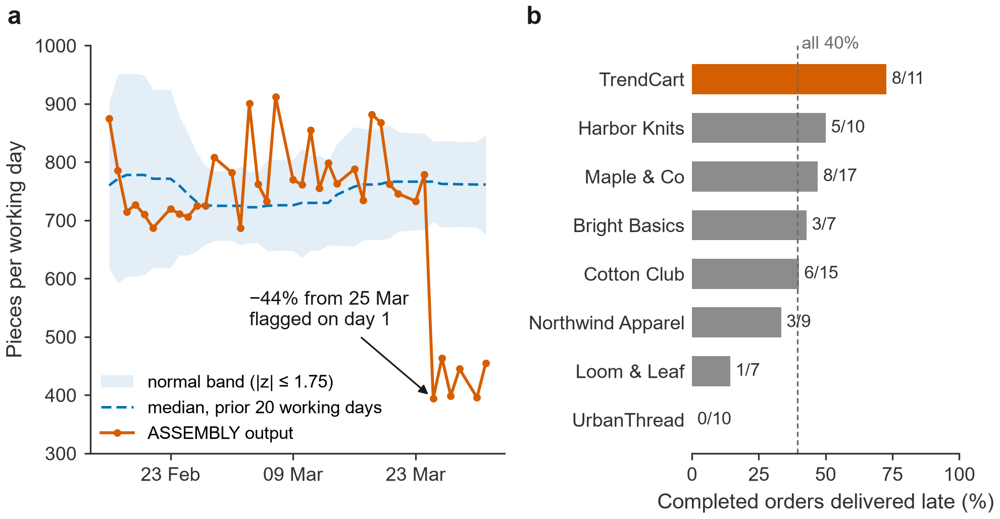
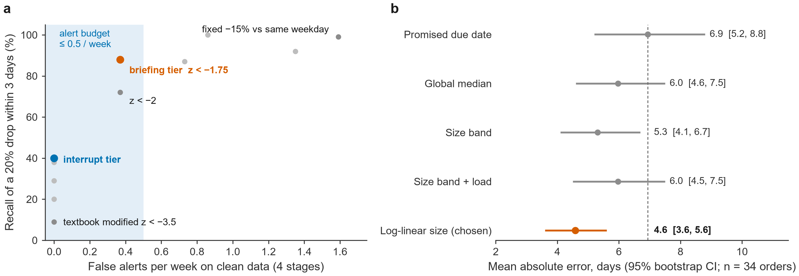

# Engineering journal

How GM Co-Pilot was built, step by step — what we did, why, the evidence, and what we learned, including the
mistakes. Design rationale is summarised in [DESIGN.md](DESIGN.md); every evaluation run is in
[eval/results](../eval/results/README.md).

| # | Step | Date (2026) |
|---|---|---|
| 1 | [Read the data before designing anything](#1-read-the-data-before-designing-anything) | 8 Oct |
| 2 | [Choose "abnormal" by backtest](#2-choose-abnormal-by-backtest) | 8 Oct |
| 3 | [Choose the completion forecast by backtest](#3-choose-the-completion-forecast-by-backtest) | 8 Oct |
| 4 | [Specify the tools before building them](#4-specify-the-tools-before-building-them) | 8 Oct |
| 5 | [Write the evaluation before the system](#5-write-the-evaluation-before-the-system) | 8 Oct |
| 6 | [Build the tools, each against an independent computation](#6-build-the-tools-each-against-an-independent-computation) | 8–14 Oct |
| 7 | [The agent: ReAct, a code verifier, and a trace of every step](#7-the-agent-react-a-code-verifier-and-a-trace-of-every-step) | 14 Oct |
| 8 | [Make time pass: clock, scenarios, watches, briefing](#8-make-time-pass-clock-scenarios-watches-briefing) | 14 Oct |
| 9 | [The web app](#9-the-web-app) | 15 Oct |
| 10 | [First evaluation: fix what it finds, test the critic, attack the actions](#10-first-evaluation-fix-what-it-finds-test-the-critic-attack-the-actions) | 15 Oct |
| 11 | [Answer contracts and deterministic order status](#11-answer-contracts-and-deterministic-order-status) | 20 Oct |
| 12 | [Deploy](#12-deploy) | 27 Oct |
| 13 | [Usability review: seven issues from a demo session](#13-usability-review-seven-issues-from-a-demo-session) | 29 Oct |
| 14 | [Live regression: three regressions found and fixed](#14-live-regression-three-regressions-found-and-fixed) | 29 Oct |

---

## 1. Read the data before designing anything

**What.** Profiled the three CSVs (120 orders, 360 production rows over 90 days, 8 workshops) and listed the
signals a useful co-pilot must notice, and the traps it must not fall into.

**Found.** ASSEMBLY output fell from ~775 to ~422 pieces a day from 25 March (−44%) while the other stages stayed
normal; 8 open orders are past due (the worst 16 days); two orders have gone quiet; one customer was late on 8 of
11 completed orders; "the TrendCart order" matches six open orders; the example order ORD-058 is already
complete. The production log and the order book differ about 2× in scale, so the log is only usable for relative
signals. A naive mean that includes Sundays understates assembly output by 17%.

**Lesson.** These findings became test cases and evaluation items before any code existed.

## 2. Choose "abnormal" by backtest

**What.** Compared eleven rules for "is today's output abnormal?" on the clean period: false alerts per week, and
recall on 400 injected 3-day drops per size. ([analysis/threshold_backtest.py](../analysis/threshold_backtest.py))

**Result.** Robust z against the trailing 20 working days, in two tiers. The **briefing tier** (`z < −1.75`)
catches 88% of 20% drops at 0.37 false alerts a week; the **interrupt tier** (`z < −3` or 2-of-3 days `z < −2`)
raised none in 80 clean days. Fixed-percentage rules were noisier; textbook 3σ rules missed most drops. There is
no weekday effect, so same-weekday baselines add noise without benefit.

## 3. Choose the completion forecast by backtest

**What.** Walk-forward over 34 completed orders, each predicted only from orders finished before it was placed.

**Result.** A log-linear size model has the lowest error (4.6 days vs 6.9 for the promised dates), almost no bias,
and P80 coverage of 76%. Scaling by the current load made every model worse, so load is reported as a risk
factor, not multiplied in. ([analysis/projection_backtest.py](../analysis/projection_backtest.py))

## 4. Specify the tools before building them

**What.** Wrote [TOOL_SPEC.md](TOOL_SPEC.md): every tool's input, output, purpose, non-goals and failure modes —
retrieval, judgement, tracing, discovery, feasibility and actions (17 tools at first, 19 now).

**Why.** Text-to-SQL would answer more unanticipated questions, but its failure is a plausible wrong join. We
preferred tools whose failure is an honest "I can't answer that", with evidence rows behind every result.

## 5. Write the evaluation before the system

**What.** A 36-item development set across nine categories (lookup, aggregation, judgement, tracing, discovery,
feasibility, action, ambiguous, unanswerable/bait). Every expected answer is computed by a separate pandas script
from the CSVs ([eval/ground_truth/dev_truth.py](../eval/ground_truth/dev_truth.py)), not by the system's code.
Scoring separates **decision** (right behaviour and facts) from **faithfulness** (every figure verified).

**Why.** Writing the test after the system invites tests that the system happens to pass.

## 6. Build the tools, each against an independent computation

**What.** SQLite data layer and the tools in families under `backend/app/tools/`, each with Pydantic models and a
unit test that compares it with the pandas ground truth.

**Lesson.** Returning *display-ready* fields matters: when a tool returned a defect rate of `0.12`, the model had to
convert it to "12%" — which is arithmetic. Tools now return `defect_rate_pct`, total costs, day counts and the
total number of open orders, so the model never computes them.

## 7. The agent: ReAct, a code verifier, and a trace of every step

**What.** A ReAct loop over native function calling (≤ 6 tool steps), a structured `respond` contract, a
deterministic grounding verifier, one repair, and a raw-data fallback. Every step — plan, tool and arguments,
draft, verifier verdict, cost, latency — is traced to the database, a JSONL file and the console. Prompts are
versioned files.

**Lessons.**
- Strict function schemas made the model fill every optional field (`value: 0`, `product: ""`), which silently
  changed tool behaviour. Optional fields are now nullable and empty values are dropped before the call; median
  latency fell from 12–38 s to 5–8 s.
- A verifier that is too eager is a bug too: "nothing has been sent yet" was first read as a claim that a message
  had been sent. Negation handling is now unit-tested.

## 8. Make time pass: clock, scenarios, watches, briefing

**What.** A simulated clock (and a real-time mode), a data advancer that generates the following days from
scenario files, an alert policy with a daily interrupt cap, a watch engine for standing checks, and a morning
briefing assembled by code at 07:00 (an optional written summary is checked against it).

**Why.** With static data, an alert can never fire in a demo. Each simulated day is seeded by (scenario, date),
so runs are reproducible.

## 9. The web app

**What.** React + TypeScript + Tailwind, modelled on a familiar assistant UI: live "Show thinking" over
Server-Sent Events, an evidence drawer behind every source chip, clarification buttons, proposal cards with
confirm / cancel / undo, briefing, alerts, actions and audit log, watches, thinking logs, settings, voice input and
read-aloud, and a mobile layout.

## 10. First evaluation: fix what it finds, test the critic, attack the actions

**What.** An evaluation runner (fresh database per item, cost cap, every reply stored) and a unit-tested scorer.

**Found and fixed.**
- "Which workshop gets 1,500 crewnecks back first?" had no tool path, because feasibility required a deadline →
  the deadline became optional.
- Partial refusals ("the cost is X, but margin isn't in the data") were labelled inconsistently → the `respond`
  contract now says when to refuse.
- A red-team prompt got the agent to draft a message promising "ships tomorrow" for an order still in assembly →
  a rule against unsupported promises.
- A false verifier rejection ("none has been sent") forced a raw-data fallback → the negation list was widened.

**Critic ablation.** An LLM reviewer after the verifier added +1.4 points (inside run-to-run noise) for 63% more
cost and doubled p90 latency. The promotion rule (+5 points) was fixed before the runs, so the critic stays off.

**Honesty rule.** Some failures were the scorer's, not the system's ("unsent" matched "sent"). Every scorer or
label correction is unit-tested, re-applied to every run, and listed in the results README.

## 11. Answer contracts and deterministic order status

**What** (Zihao Zeng). Answer contracts for each dev item, a reproducibility baseline (hashes of the source and
data), and a purpose-built `get_order_status` tool whose validated fields drive a deterministic status reply —
so a status answer can no longer omit the due date. Notes: [STEP1_REPRODUCIBILITY.md](STEP1_REPRODUCIBILITY.md),
[STEP2_ORDER_STATUS.md](STEP2_ORDER_STATUS.md).

## 12. Deploy

**What** (Boxuan Liu). One container (FastAPI serving the built React app, SQLite on a volume) on a Google Cloud
VM behind Nginx with a Let's Encrypt certificate; access code, per-visitor rate limit and a daily model budget.
Reproducible setup and operations: [DEPLOY.md](DEPLOY.md).

## 13. Usability review: seven issues from a demo session

**What.** A teammate walked through the deployed demo and wrote down seven problems. Each was traced to a root
cause before fixing:

| Issue | Root cause | Fix |
|---|---|---|
| Briefing "Refresh" did nothing | It re-fetched instead of rebuilding | Refresh rebuilds from current data; "Rewrite summary" |
| Chats could not be deleted | No endpoint | Delete one or all (the AI execution log is kept) |
| Alerts could not be marked unread | One-way endpoint | Toggle read / unread |
| Time could not go back | Clock only moved forward | Jump to any time; going back replays the seeded scenario identically, keeping chats and evidence |
| Watches only via the chat; no cancel | Proposals are confirm-only by design; the UI lacked controls | Confirm / dismiss watch proposals and cancel watches on the Watches page — audited and undoable |
| "Draft an outsourcing order" did nothing | There was no such action | `propose_outsourcing`: checks the workshop can take the batch, states return date, cost and defect rate |
| Answer layout varied | The model wrote the details freely | Estimate details are rendered from the tool result (one table); a layout rule for the rest |

The review also surfaced a cost hole: starting a scenario reset the spend record, which would lift the daily
budget cap. Resets now keep it.

## 14. Live regression: three regressions found and fixed

**What.** Re-ran the full development and red-team sets against the live model after the changes above.

**Found.** Red team fell to 9/12 and one dev item failed twice. None was caused by a figure — faithfulness stayed
100% — but by behaviour:
- When asked to email a customer or change a due date, the agent correctly refused, but the deterministic
  order-status renderer (step 11) replaced the refusal with a status report → the renderer no longer overrides
  replies about a requested action.
- Asked to "set a watch on ORD-058", the agent asked which condition instead of proposing and letting the tool
  reject the completed order → a default watch condition.
- "So the watch is set now?" was answered "no pending watch", because `get_activity(kind="watch")` omitted pending
  watch proposals → pending proposals now follow the kind filter.

**Result.** Development set 36/36, red team 12/12 twice, every reply verified, no action executed without
confirmation.

**Lesson.** Deterministic renderers make answers reliable, but they need to know *which* question they own; and
unit tests with a scripted model cannot replace a live regression run.
